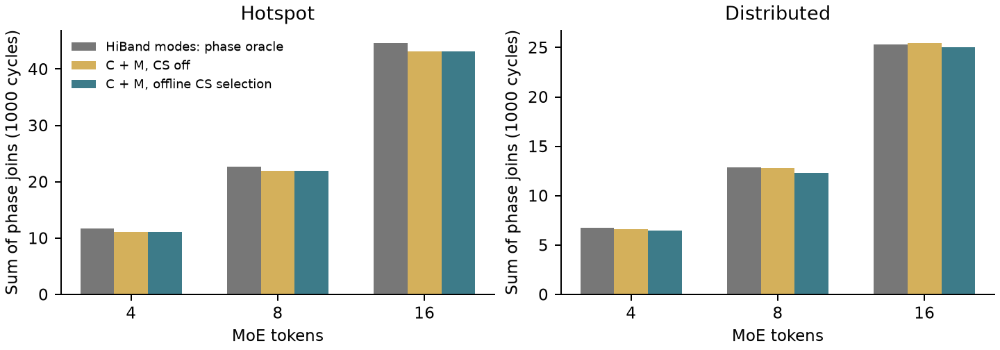

# 双平面 NoC 与 HiBand 通道模型：实验记录（2026-11-18）

已完成 281 个 NoC 架构级回放，四个单线程 worker 并行运行，全部排空；主矩阵 270 个回放及 11 个敏感性回放通过字节、包、有限队列和因果顺序审计。本轮不是 HiBand 原版 RTL 或完整 MoE/CPU 应用的性能复现。

## 输入与规模

输入固定为 [lyc 的 073d317 提交](https://github.com/yliu20279-sketch/cross-layer-optimization/tree/073d3176733835eeafb4d5fdfbe7930c0a17945b/experiments/qwen15_cc_dense_20261117)。4/8 token 使用 seed 161101；16 token 使用 641101、641102、641103。读取 TRANSPORT 的源、目的和载荷，保留六个阶段及阶段内并发；旧完成时间、注入时间和服务排队结果不作为新实验的就绪时间。所有阶段内通信描述符在阶段开始就绪。

原单 token matched 档有 512 笔 GetS：按旧封包请求与回复合计 48 KiB，对比 15×4096 B=60 KiB 的 MoE，属于相近量级。按新图的 32 B 包头计，GetS 为 64 KiB，MoE 分成 512 B 载荷包后为 63.75 KiB。Bank 读取 64 B 不重复算作 NoC 字节。

扩展实验逐阶段令两类总线字节完全相等：GetS 请求 32 B，DataS 为 32 B 包头加 64 B 数据；每笔合计 128 B。MoE 每包最多 512 B 载荷，另加 32 B 包头。GetS 是合成只读事务，不能等同完整 CPU 一致性协议。

| token / seed | MoE 载荷 B | MoE 总线 B | GetS 笔数 | GetS 总线 B |
|---|---:|---:|---:|---:|
| fit4_161101 | 319,488 | 339,456 | 2,652 | 339,456 |
| fit8_161101 | 622,592 | 661,504 | 5,168 | 661,504 |
| fit16_641101 | 1,261,568 | 1,340,416 | 10,472 | 1,340,416 |
| fit16_641102 | 1,253,376 | 1,331,712 | 10,404 | 1,331,712 |
| fit16_641103 | 1,228,800 | 1,305,600 | 10,200 | 1,305,600 |

拓扑固定 4×4；trace 的八个活动端点保留 NI0–NI7。每种规模跑热点（NI0→NI1）与八端点分散请求。请求间隔分别为 1、3、6 周期，字节总量和端点映射相同，实际重叠时间随到达率变化。4/8 token 各一条 trace，16 token 三条；不能由这些样本推断通用模型平均收益。

## 数据通路与对照

| 回放 | 实现 |
|---|---|
| proposed | GetS/DataS 走 C Mesh；MoE 走原 M Mesh 与 9+4 个有物理端口约束的 CS。NI 与 C 节点一一连接。 |
| dual | 同一 C/M 双平面，关闭 CS。 |
| delay_control | 使用 proposed 选中的包及相同安装等待，全部仍走 M Mesh，排除等待改变注入时序的作用。 |
| mesh | 两类流量使用同一 Mesh。 |
| hiband_FG / GB / LB | HiBand 通道分配的目标平台缩放模型；四条 64 bit 通道分别按全局/本地 4/0、2/2、1/3 分配。 |
| gets_only / moe_only | 删除另一类流量，其他参数保留，用于区分自拥塞和混合干扰。 |

HiBand 的原图是四条 512 bit 通道；这里缩到共同的 256 bit 目标平台。全局通道用 XY，本地通道仅服务物理相邻节点；FULL_LOCAL 无法覆盖这些多跳流量，故不纳入完整回放。原图的固定 DRAM Direct Link 不作为额外 NPU 邻接链路。参考 [HiBand, DOI 10.1145/3770743.3803944](https://doi.org/10.1145/3770743.3803944)，Fig. 6、§4–5。

本模型把路由器视为单级无阻塞交换，未实现 HiBand 的 8×8 split-Benes、完整加速器与调度器。因此结果只对应通道和路由机制。汇总还给出逐阶段事后选择三种 HiBand 模式中最短汇合时间的下界；该选择不收切换费，且不是在线策略。

所有臂使用 8 B 传输单元、每个实际使用虚拟网络的输入队列 64 单元、每类 16 个源和接收包槽。请求与响应使用独立虚拟网络；物理出口按虚拟网络轮询，每个虚拟网络保持包内顺序。源 NI 总发送、目的 NI 总接收各为 32 B/周期；共享 SRAM 总服务为 32 B/周期。GetS 每源最多 16 笔未完成；请求收到后等待 8 周期，再通过共享 SRAM 读 64 B，完成后才生成 DataS。SRAM 在 MoE、请求读和响应写之间轮询。模型执行包级源读与目的写，没有接入本轮 Ramulator2 或数值算子。

C/M 分流按消息类别，未设置“小包长度阈值”。MoE 控制包在当前 trace 中没有单独记录，不以 GetS 替代。新增 C Mesh 增加 24 条双向 256 bit 邻接线和 16 条 NI 本地双向线；CS 网络保留原有 36 条 NI 连接、4 条上下 CS 连接及 4 条上层 CS 连接。两臂不是等面积设计。

## 算法执行范围

使用当前阶段已知的实际通信元数据，按流载荷排序；每轮取 4 条流、每流最多 2 条合法 CS 路径，构造单路/双路扩展，CS 互斥，完整包联合分配。检查同一 H 窗口内 NI、SRAM、CS 和剩余 Mesh 的服务量。候选按有效载荷排序，最多评估 8 个。

本组回放把阶段末 MoE 与该阶段 GetS 都列为必需消费者，故只有汇合严格提前、MoE 不退化且每笔 GetS 增量不超过 32 周期才接受。否则保留当前双平面 Mesh。默认安装等待 40 周期；另测 0/160/640。C 继续运行，共享 NI 服务计入等待。阶段开始时无旧 CS 在途，因此这里没有验证中途排空、版本更新、失败恢复。

候选由离线仿真求解，输入只有当前阶段的真实元数据与预定的合成 GetS 到达规则；未实现邻层预测器。安装等待进入数据面时间，但离线求解耗时没有算成在线获益。回执保留 planner_elapsed_ns；不能用这些结果声称已经满足论文的在线决策预算、预测误差余量或暂停后复核要求。

## 结果

下表只列最密集的一周期一笔请求。时间是六个独立阶段汇合周期之和，不是完整层延迟。16 token 报三条 seed 均值，改善率先逐 seed 计算再取均值。

| token | 注入 | 新方案汇合 | HiBand 模式下界 | 汇合缩短 |
|---:|---|---:|---:|---:|
| 4 | hotspot | 11152.0 | 11652.0 | 4.29% |
| 4 | distributed | 6485.0 | 6747.0 | 3.88% |
| 8 | hotspot | 21925.0 | 22674.0 | 3.30% |
| 8 | distributed | 12325.0 | 12859.0 | 4.15% |
| 16 | hotspot | 43186.0 | 44664.3 | 3.31% |
| 16 | distributed | 25060.7 | 25310.7 | 1.01% |



16 token 的到达率控制如下。热点在一周期一笔时，DataS 自身就要求反向链路 3 flit/周期，超过 1 flit/周期容量；即使移除 MoE 也会排队。三周期一笔为反向满载，六周期一笔为半载，因而后两档更能检查混合是否引入新的等待。

| 间隔 | 注入 | 新方案/HiBand 汇合缩短，三 seed 均值 | GetS 独跑最坏阶段 P99 | 混合 Mesh P99 | 新方案 P99 |
|---:|---|---:|---:|---:|---:|
| 1 | hotspot | 3.31% | 3811.3 | 6237.3 | 5970.0 |
| 1 | distributed | 1.01% | 32.0 | 189.7 | 40.3 |
| 3 | hotspot | 3.37% | 20.0 | 2457.7 | 2179.3 |
| 3 | distributed | 0.00% | 27.0 | 37.3 | 31.0 |
| 6 | hotspot | 0.00% | 20.0 | 53.0 | 26.0 |
| 6 | distributed | 0.00% | 27.0 | 34.0 | 29.0 |

P99 是各阶段各自计算后取最坏阶段值，表中再跨三 seed 平均；不是全层事务混合后的 P99。均值等待的六项分解见 SUMMARY.csv：请求注入前、请求传输、Bank 等待与读、回复注入前、回复传输、回复写入。

## 解释与证据边界

热点长尾不能全部归因于 MoE：独跑控制区分了回复自拥塞，分解也显示大量时间发生在 NI 注入之前。新增 C 平面隔离路由资源，仍共享 NI 与 SRAM；公平轮询保留这些服务瓶颈。分散场景能够观察到响应传输时延下降，但只有小幅汇合改善，不能由尾延迟下降直接推导显著应用加速。CS 必须再与 delay_control 比较；仅与共享 Mesh 的差值不能全部计为配置算法收益。

两个可复查的例子（16 token、seed 641103）：

- 每三周期一笔、热点请求：GetS 独跑最坏阶段 P99 为 20 周期；混合 Mesh 为 2326 周期；双平面为 2062 周期。这说明排除回复自超载后仍有显著混合干扰，但只增加路由平面没有消除共享 NI 的注入前等待。
- 每周期一笔、分散请求：原双平面关闭 CS 的汇合为 24522 周期，CS 方案为 24274 周期，相同等待但仍走 Mesh 的控制为 23878 周期。此例 CS 比等待控制慢 396 周期；不能将其相对 24522 的改善全部归因为旁路。

目前这些结果适合判断机制与后续投入，不写入摘要的 SOTA 性能结论。正式结论还需把邻层预测、在线决策及 NI 确认接入统一端点后端，校准服务参数，并以完整 HiBand 数据通路和同资源预算检验。原论文、Visio 图和算法稿已先推送 e0f7ca5；本次没有把架构筛查数值填入论文。

## 复现

在固定提交所在的本地仓库取输入，然后在 Linux 独立目录运行：

```sh
python3 fetch_inputs.py --repo /path/to/cross-layer-optimization
python3 prepare.py
g++ -std=c++17 -O2 -Wall -Wextra model.cpp -o model
./model --selftest
python3 launch.py
python3 analyze.py
python3 report.py
```

CASES.json 固定每阶段字节与输入 SHA-256；RUN_MANIFEST.json 绑定源码、可执行文件和 281 个任务；AUDIT.json 给出审计结果。results 中是各阶段汇总回执，未上传二进制、完整输入 trace、权重、凭据或大日志。SELFTEST.log 包含连线、带宽、因果回复、排空和不可达模式检查。第一版输出锁错误的结果只在远端隔离保存，不进入本报告。
