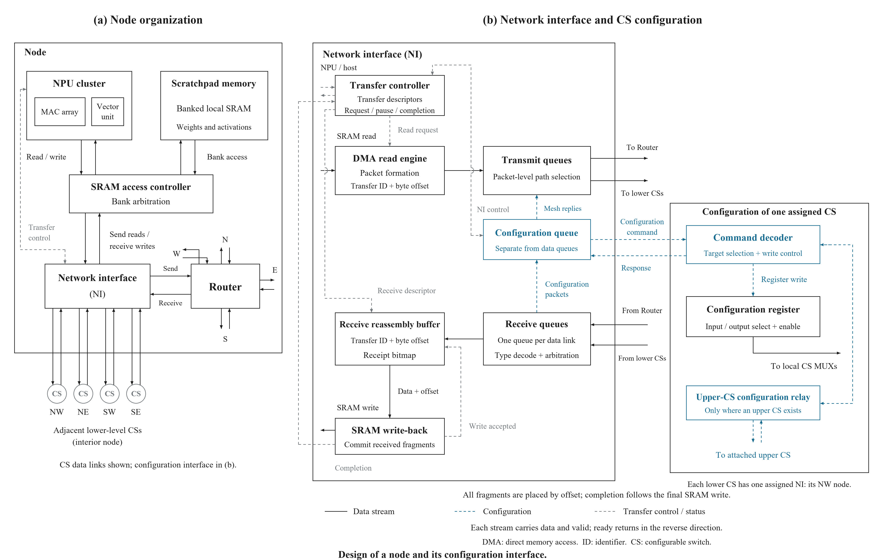

# Node 与 NI 配置接口图

2026-11-09 的 Node/NI 图纸修订，与 [两级 NoC 与 CS 数据通路图](../20261109_two_level_cs/README.md) 配套。当前图为 `figures/05_node_configuration_assignment.png`，同时提供可编辑 SVG。



## 本版内容

- 左图展开 NPU cluster、局部 SRAM、bank 仲裁、NI、Router，以及与最多四个相邻下层 CS 的独立收发连接。角 Node 只接一个、边 Node 两个、内部 Node 四个，总体 36 条 Node–下层 CS 数据连接。
- 右图展开有限收发队列、按偏移重组/写回、完成反馈，以及 NI 到 CS 侧配置器、配置寄存器和上层配置转接的接口。
- 每个下层 CS 固定由其西北角 Node 的 NI 配置。不是全网只配置一个 CS；九个下层 CS 各有唯一配置来源。左图只画 CS 数据连接，配置分工集中在右图说明。
- 配置包经普通 Mesh 送到指定 NI，再使用本地控制接口到达 CS 侧配置器。四个上层 CS 经对应下层 CS 的固定控制转接配置。这里确实需要控制硬件和本地导线，不是零成本复用数据线，也没有新增 Node–上层 CS 数据直连。
- 采用整包分流、按传输标识和偏移写回 SRAM，全部片段实际写回后才报告完成。网络更新采用暂停新传输、排空、写配置、收齐响应、恢复的顺序。

字段、所有权映射、握手、缓冲、响应匹配、切换规则和局限详见 [接口说明](README_v3.md)。这些是当前设计选择，不将其写成老师指定的全部实现细节。

## 生成与局部检查

本图实际在 Windows、Python、Pillow 13.0.0、Times New Roman 字体下生成。绘图和布局检查使用 `C:/Windows/Fonts/times.ttf` / `timesbd.ttf`；其他系统需要先调整字体路径，不能直接声称跨平台绘图已验证。

在本目录执行：

```powershell
python -m pip install -r requirements.txt
python draw_node_v3.py
python interface_model_checks.py
python check_node_v3.py
python verify_release.py
```

`draw_node_v2.py` 在本包中保留为绘图基元依赖，导入不会自动绘制旧图；当前入口是 `draw_node_v3.py`。

已附检查报告：

- `static_checks_v3.json`：图形文件、文字与线条/方框边界、邻接方向、13 个 CS 的唯一配置来源与控制可达性。
- `interface_model_checks.json`：24 组有限缓冲乱序/写入停顿模型用例，目标/长度/重复片段检查，16-NI 暂停屏障、响应事务匹配及错误后保持暂停；80 组 MUX 编码情况。
- `release_check.json`：发布文件、大小和 SHA-256。

## 验证范围

这些 PASS 只属于静态图纸和小规模接口规则模型，不是 RTL、CDC、布线时序、完整流控死锁或应用性能的验收。队列容量、物理 SRAM 带宽、配置开销和长链路寄存器需要在后续实现中确定并测试。未修改已有仿真器、基线、运行任务或历史 RTL。

## 来源与发布范围

从本地 Node 设计工作目录选择性归档当前图、生成脚本、接口说明和局部检查，不包含全部开发目录或旧图。构图参考 DATE 2013 Fig.1(b)、EIGEN HPCA 2025 Fig.5(c)、RHT_NoC 2025 Fig.8；具体采用范围见接口说明。

论文 PDF、原论文裁图、模型权重、Trace、凭据、仿真运行日志及二进制均未收录。保留仓库既有权利约定，不为第三方论文或资源重新授权。
