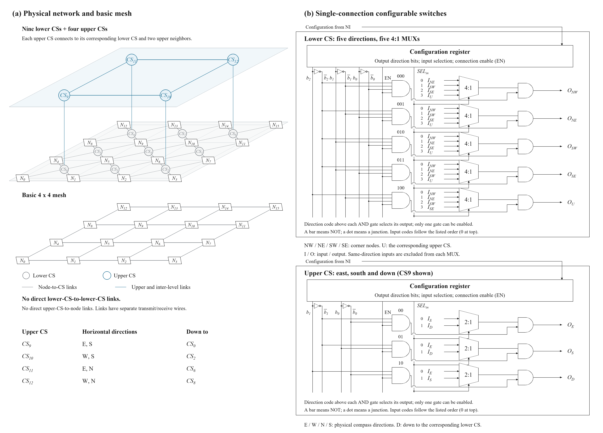

# Two-level NoC and configurable switch circuits

2026-11-09 NoC 设计图纸及独立绘图脚本。此目录不修改 CA、benchmark 或历史 NoC 源码快照。



## 当前结构

- 16 个计算节点，9 个下层 CS 和 4 个上层 CS；基础 4×4 Mesh 单独作为对照显示。
- 每个下层 CS 连接所在 2×2 区域的四个角节点，方向为 NW、NE、SW、SE；第五方向 U 用于连接对应上层 CS。只有 CS0、CS2、CS6、CS8 实际连接 U，其余 U 输入须固定无效。
- 上层仅连接对应下层 CS 和两个上层邻居，不直接接计算节点。下层 CS 之间没有独立直连。
- CS9 的方向为 E/S/D；CS10 为 W/S/D；CS11 为 E/N/D；CS12 为 W/N/D。D 分别接下层 CS0、CS2、CS6、CS8。
- 每条连接使用独立发送、接收数据线束；每个 CS 在一组有效配置下至多建立一条有向输入到输出连接。

## CS 电路

下层每个输出用一个 4:1 MUX，只连接其他四个方向的输入；上层每个输出用一个 2:1 MUX，只连接其他两个方向的输入。由接线直接排除同方向输入接回同方向输出，不另设自连接检查模块。

配置寄存器提供输出方向、输入选择码和连接使能 EN。图中反相器产生方向位的反值，与门匹配输出方向编码，并直接驱动对应输出使能。方向位只可能匹配一路输出；未使用的编码全部关闭。输入选择码按当前输出 MUX 中从上到下列出的允许输入编号，而非全局物理方向编号。

下层输出编码为 000=NW、001=NE、010=SW、011=SE、100=U；输入选择码为 2 位。上层输出编码为 00=该实例的 E/W 方向、01=该实例的 N/S 方向、10=D；输入选择码为 1 位。EN=0 时全部关闭。当前电路表示数据及有效标志的成组使能。

## 生成图纸

```sh
python -m pip install -r requirements.txt
python draw_figures.py
python verify_release.py
```

脚本不依赖原工作目录或旧设计文件，不联网、不启动仿真器。已在 Python 3.12.14 和 Pillow 13.0.0 环境运行，输出 PNG 与本次审阅图逐像素一致。

输出为 `figures/noc_topology_cs.png`（4400×3160）和同名 SVG。PNG 使用系统字体；优先 Times New Roman，其次 Liberation Serif 或 DejaVu Serif。可用 `NOC_FIGURE_FONT_DIR` 指定字体目录。替代字体会改变字形及像素结果。SVG 保留可编辑矢量图元和下标；字体文件不随仓库分发。

## 核对范围

`checks/output_decode_truth_table.json` 仅枚举下层 3 位、上层 2 位方向编码及 EN 的全部组合，检查至多一路输出使能、保留编码全部关闭。该静态核对不是 RTL 仿真、NI 配置协议验收、线长时序验证或应用性能结果。

本次只发布图纸、绘图源文件和静态核对记录；没有把旧大交换矩阵、外围共享选择器或半双工换向方案的验证结果套用到本设计。新的 RTL、流控、配置提交与完整仿真实验应另行记录，不覆盖历史快照。

`verify_release.py` 检查本目录文件完整性、PNG/SVG 尺寸、译码真值表，并生成文件 SHA-256 清单；不会修改设计电路。
